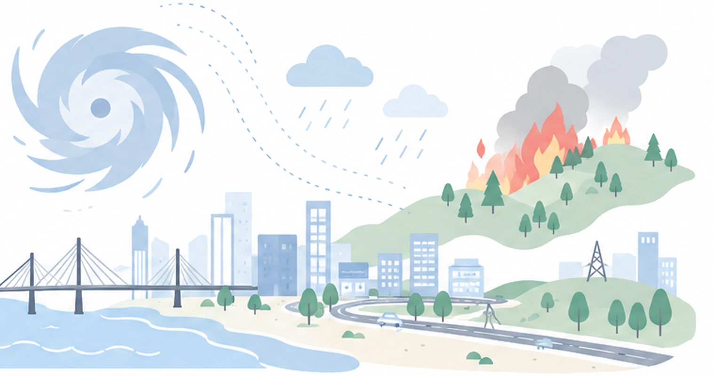
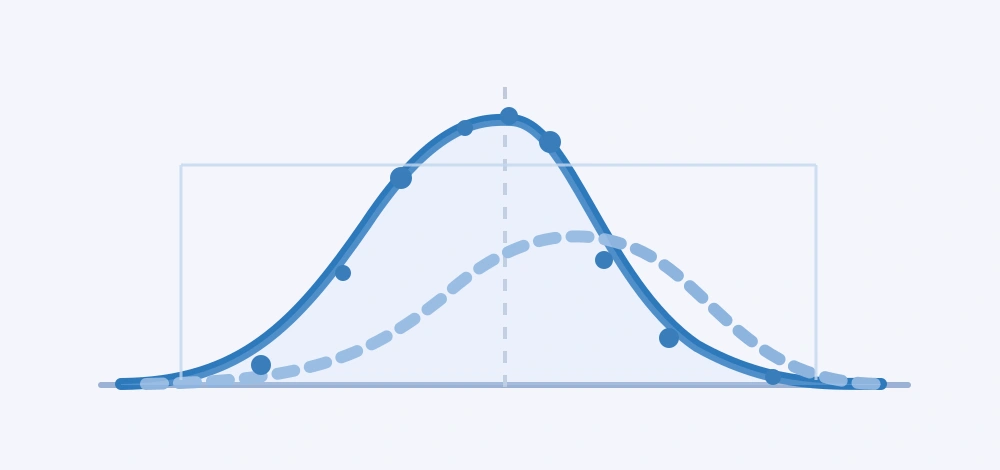
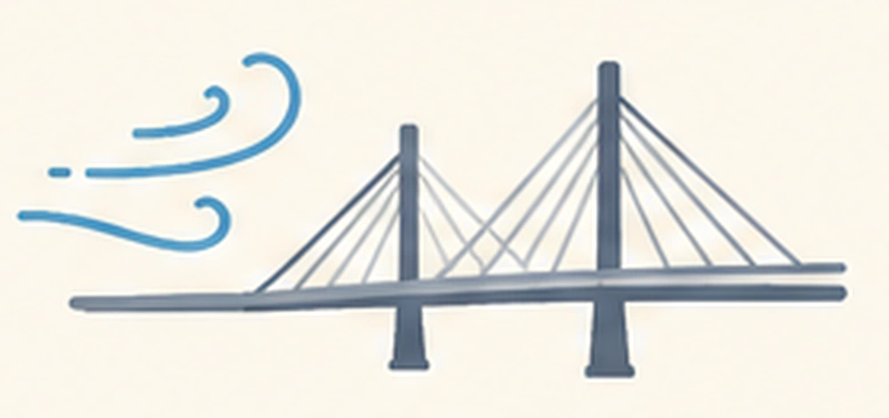
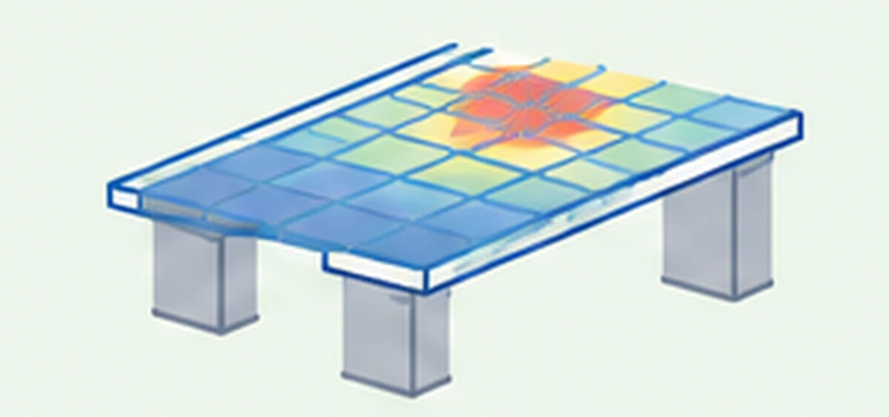
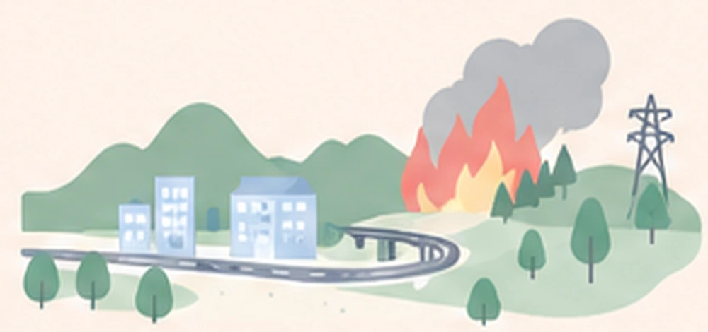

<a class="skip-link" href="#main">Skip to content</a>
<header class="site-header">

  <a class="identity" href="index.html" aria-label="SHARE Lab home">
  SHARE Lab.
  DANKOOK UNIVERSITY
</a>

  <button type="button" class="menu-toggle" id="menu-toggle" aria-expanded="false" aria-controls="top-nav" aria-label="Toggle navigation">☰</button>
  <nav class="top-nav" id="top-nav" aria-label="Main navigation">
<a href="index.html" class="active" aria-current="page">Home</a><a href="people.html" >People</a><a href="research.html" >Research</a><a href="publications.html" >Publications</a><a href="news.html" >News</a><a href="contact.html" >Contact</a>  </nav>

</header>
<main id="main">

  <section class="hero" aria-labelledby="hero-title">
    

 Systems and Hazards Analysis for Resilience to Extremes

      <h1 id="hero-title">Advancing Infrastructure Resilience.</h1>
      
Through <strong>System–Hazard Interaction Analysis</strong>  and <strong>Uncertainty Quantification</strong>.

      
<a class="btn btn-primary" href="research.html">Research</a><a class="btn btn-outline" href="people.html">People</a>

    

    

      
      
INFRASTRUCTURE × HAZARDS × UNCERTAINTY

    

  </section>
  <section class="section intro-grid">

ABOUT THE LAB
<h2>Engineering insight. Quantified uncertainty. Resilient systems.</h2>

SHARE Lab explores the behavior and performance of built infrastructure under uncertain environmental loads and natural hazards. By integrating probabilistic methods, computational modeling, and data-driven analysis, we aim to understand risk and support more resilient infrastructure systems.

Uncertainty QuantificationNatural HazardsSystem InteractionsRisk & Resilience

</section>
  <section class="section" aria-labelledby="home-research-title">

OUR EXPERTISE
<h2 id="home-research-title">Research Areas</h2>
<a class="link-arrow" href="research.html">Research</a>

    
<a class="research-card" href="research.html#uq">

01 / Research Area
<h3>Uncertainty Quantification</h3>
Quantifying uncertainties in hazards, structural properties, numerical models, and system performance.

</a><a class="research-card" href="research.html#hazards">

02 / Research Area
<h3>Natural Hazards</h3>
Characterizing natural hazards and their interactions with buildings and infrastructure systems.

</a><a class="research-card" href="research.html#wind">

03 / Research Area
<h3>Wind Engineering</h3>
Understanding extreme wind environments and wind-induced structural performance.

</a><a class="research-card" href="research.html#structural">

04 / Research Area
<h3>Structural Engineering</h3>
Evaluating the behavior and safety of structural systems using mechanics and computational analysis.

</a><a class="research-card" href="research.html#resilience">

05 / Research Area
<h3>Infrastructure Resilience</h3>
Assessing risk and resilience across interconnected infrastructure systems exposed to natural hazards.

</a>

  </section>
  <section class="section split-home" aria-label="The research group and publications">

PEOPLE
<h2>Research is a team endeavor.</h2>
Get to know the researchers exploring infrastructure, natural hazards, and uncertainty.
<a class="link-arrow" href="people.html">People</a>
WJ
<strong>WoongHee Jung</strong><small>Professor · Dankook University</small>

  

PUBLICATIONS
<h2>New ideas. Shared knowledge.</h2>
Read our peer-reviewed research in uncertainty quantification, hazard assessment, and structural resilience.
<a class="link-arrow" href="publications.html">Publications</a>
<small>2026 / Journal of Waterway, Port, Coastal, and Ocean Engineering</small><strong>Validation of Hazard-Consistent Probabilistic Scenario Optimization for Updating Storm Surge Hazards in the Greater New Orleans Area, Louisiana</strong>

<small>2025 / Coastal Engineering</small><strong>Advances in spatiotemporal storm surge emulation: database imputation and multi-mode latent space projection</strong>

</section>
  <section class="section latest-home">

SHARE LAB
<h2>News & Updates</h2>
<a class="link-arrow" href="news.html">News</a>

Research news and laboratory updates will appear here as the group grows.
</section>

</main>
<footer class="site-footer">

  
<a class="identity" href="index.html" aria-label="SHARE Lab home">
  SHARE Lab.
  DANKOOK UNIVERSITY
</a>

Systems and Hazards Analysis for Resilience to Extremes Advancing Infrastructure Resilience through System–Hazard Interaction Analysis and Uncertainty Quantification

  
<strong>Department of Civil and Environmental Engineering</strong> Dankook University Engineering Building II, Room 214, Dankook University, Yongin, Republic of Korea <a href="mailto:wjung@dankook.ac.kr">wjung@dankook.ac.kr</a> <a href="tel:+823180053483">031-8005-3483</a>

© SHARE Lab · Dankook UniversityDesigned for research, built for resilience.
</footer>

